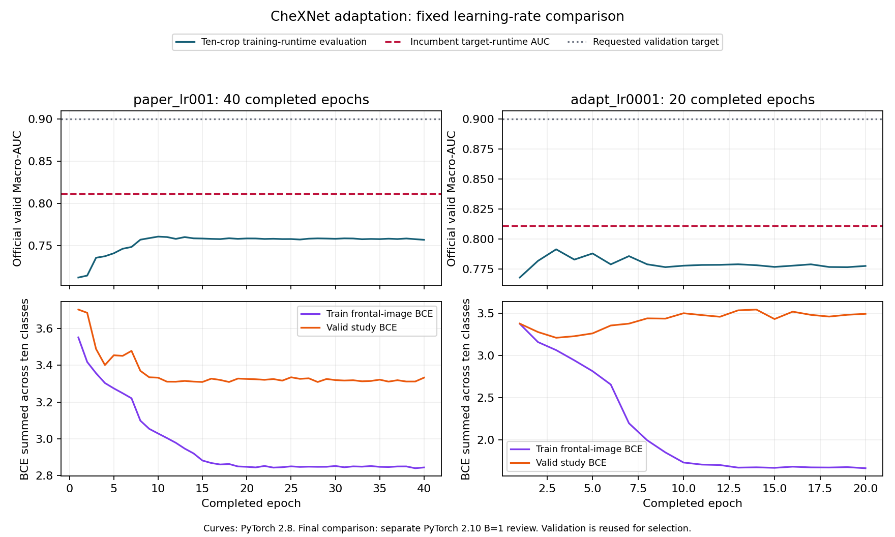

# CheXNet 正式实验结果

两组训练均已完成，代码冻结提交 `cc2641a88a6dfb443361484e3bcc4f886031788f`。目标环境为Python3.12/PyTorch2.10，batch1。

| 初始学习率 | 实际完成轮数 | 最佳AUC轮次 | 十裁剪验证AUC（目标环境） | 中心裁剪验证AUC（目标环境） |
|---|---:|---:|---:|---:|
| 0.001（论文参数基准） | 40 | 10 | 0.760435 | 0.754451 |
| 0.0001（适配对照） | 20 | 3 | **0.791554** | 0.785510 |

目标环境中最佳CheXNet验证AUC为 **0.791554**，原交付为 **0.811122**。
每种裁剪按实际部署形状独立前向；中心裁剪没有使用十裁剪批次中抽取的近似结果。
按228名验证患者配对重采样1000次，各候选区间及逐类AUC见[汇总](research/chexnet_completion_20261027.json)。反复选型后的区间仍不是独立测试证据。

最佳CheXNet较原交付低 **1.9568个百分点**；患者配对差值的95%描述性区间为 **[-3.2648, -0.6968]个百分点**。八个逻辑候选的验证预测均已再次按图像顺序、CSV摘要、运行环境重建，指标与复核报告一致。

为区分单模型与集成，在相同目标环境和优先正位聚合下重新核对原交付的三个成员：

| 原交付成员 | 输入 | 单模型验证AUC |
|---|---:|---:|
| DenseNet121 | 384 | 0.796692 |
| EfficientNetV2-S | 448 | 0.801963 |
| ResNet18类别空间注意力 | 384 | 0.780128 |
| 三成员固定逐类融合 | 上述输入 | **0.811122** |

CheXNet同样使用DenseNet121，但本轮224输入、RGB/256十裁剪及训练配方的适配，没有超过已有DenseNet121单模型。两套训练与输入配置不同，不能把差异单独归因于输入分辨率。

0.0001组训练损失持续下降，验证BCE在第3轮后总体上升；训练环境的AUC从最佳0.791568降到第20轮0.777752，显示过拟合。本轮结果不支持仅靠增加训练轮数来提升得分。0.001组最小验证BCE在第28轮，但其目标环境十裁剪AUC为0.758309，仍低于按AUC选出的第10轮。

测时使用种子2052预先选定的100张验证原图、5张预热图，连续三轮。包含完整检查所需图像读取、RGB预处理、裁剪、模型推理、聚合及CSV写入/flush/fsync；模型初始化不计。结果与冻结概率的最大差均为0.0。

| 较优学习率组的部署模式 | 本机平均耗时 | 本机≤100ms筛选 |
|---|---:|---|
| 十裁剪 | 156.20ms | 未通过 |
| 单中心裁剪 | 120.80ms | 未通过 |

这是RTX4070 SUPER上的**验证样本**测时，样本与原交付的测试测时不同，不用于直接归因速度差异，也不等同于官方T4结论。

没有验证AUC与本机耗时均符合替换条件的CheXNet单模型，保留原76.78分提交文件；没有为较弱候选重新读取测试集。
验证AUC≥0.90目标尚未达到。
T4未实测，未执行比赛网站提交。暂停的AUC/DINOv2方向没有恢复。
